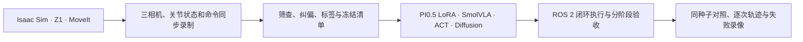

# 项目展示材料

**Unitree Z1 四物体桌面抓取与 VLA 训练**。当前实现了从场景、夹爪接触和 ROS 2 控制，到三相机同步示教、数据冻结、LoRA 微调、同种子闭环评估与失败分析的仿真流程。早期还实现了实机视觉接近探索，并保留不同策略和几何参数的试验。

| 可核对结果 | 数值与材料 |
| --- | --- |
| 最终冻结数据 | 1,762 条轨迹，1,703,757 张三路 RGB 图像。[训练集清单](../../pi05_lora_workspace/pi05_current_round_20261111/训练集逐条清单.csv) |
| PI0.5 训练 | 100,000 次实际 AdamW 更新，模型预测 30 步。[结果](../../pi05_lora_workspace/pi05_current_round_20261111/completed.json) · [重载验证](../../pi05_lora_workspace/pi05_current_round_20261111/final_checkpoint_reload_verified.json) |
| 碰撞对照 | 120 个配对试次，在执行 15 步下，只过滤夹爪与桌面的碰撞，成功数由 7 次增至 12 次。主要失败仍是抓取失败。[逐种子结果](../../smolvla_eval/pi05_final_execute15_finger_table_filtered_30each_20261118/paired_comparison_from_first_inference.json) |
| 执行窗口对照 | 在保持同一碰撞设置的 60 个试次里，15 步成功 8 次、30 步成功 2 次。[逐种子结果](../../smolvla_eval/pi05_final_filtered_execute30_15each_20261118/paired_comparison.json) |
| 仍待解决 | 最终四物体模型的闭环成功率仍低。报告按抓取、触桌、瓶子倾倒、搬运/释放分开记录。[原始测评](../../smolvla_eval/pi05_final_four_objects_50each_20261117_145347/pi05_sim_eval_20261117_150326/report.json) |

可结合实际承担工作，在简历中描述：

> 搭建 Unitree Z1 的 ROS 2、MoveIt 与 Isaac Sim 桌面抓取工程。实现三相机与关节/动作对齐的示范采集、纠偏数据治理和 PI0.5 LoRA 微调。冻结 1,762 条示范，用同种子对照量化执行窗口和碰撞设置对闭环成功率的影响，并按轨迹与三视角录像定位抓取失败。

展示视频可从 [失败合集的章节与导出记录](../../video_exports/pi05_first15_failures_5x_20261118_002010/completed.json) 选择。过往可播放文件及完整相机记录见[外部资产清单](../../manifests/external_artifacts.json)。
