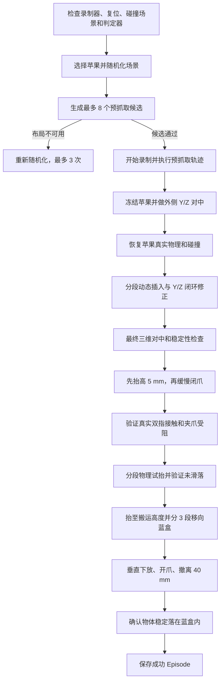

# 当前苹果抓取全流程与横向误差分析

> 检查日期：2026-09-07
> 依据：当前工作区代码及本次运行日志（`python3_38853_...log`、`python3_38857_...log`、`python3_38859_...log`）
> 本文只记录和分析当前实现，没有修改控制代码。

## 1. 先给结论

当前反复出现的“横向误差”，主要不是苹果识别位置随机变化，也不是 MoveIt 没有规划出轨迹，而是**控制器要求的夹爪局部 Y 修正，没有等量地表现为测量到的局部 Y 位移**。

本次运行中：

- 冻结对中结束时，苹果局部坐标为 `(x=171.1, y=-5.1, z=19.0) mm`，Y 没有达到目标 `0 ± 2 mm`，只是落入可恢复范围。
- 恢复物理后的动态阶段连续发出了约 `-3.5 ~ -6.0 mm` 的局部 Y 修正，但测得的 Y 只从 `-9.2 mm` 缓慢改善到 `-4.7 mm`。
- 与此同时，苹果局部 X 从 `169.3 mm` 连续变成 `151.9 mm`，说明大量“横移”实际表现成了轴向深入，并伴随世界坐标 Z 逐步下降。
- 随后的安全桥检测到 `Finger/table contact detected`，停止并锁存运动。因此本次停止的直接原因是**夹指碰桌**，不是规划器找不到路径，也不是最后的抓取成功判定太严格。

根因组合是：**75° 抓取姿态下局部轴与世界轴耦合 + 实际轨迹跟踪/坐标变换残差 + 苹果策略仍允许反复做同方向横向微调 + 苹果没有启用桃子已有的动态世界 Z 下限和深度保护**。

## 2. 坐标含义

所有对中误差都在 `gripperStator` 局部坐标系中计算，不是世界坐标：

| 轴 | 当前流程中的含义 | 苹果目标 |
|---|---|---:|
| 局部 X | 苹果进入两指之间的深度 | 动态停止约 `0.152 m`，最终中心约 `0.141 m` |
| 局部 Y | 两指之间的横向居中误差 | `0.000 m` |
| 局部 Z | 苹果相对固定指支承面的高度 | 进入和最终均约 `0.017 m` |

机械臂以约 75° 的倾斜姿态抓苹果，因此局部 Y、局部 Z 都不是世界坐标的纯水平或纯竖直方向。代码通过当前 `gripperStator` 姿态把局部修正旋转成世界坐标位移：

```text
world_correction = rotate_vector(stator_orientation, local_correction)
```

这意味着一次“只修局部 Y”的命令，也可能同时改变世界 X、Y、Z；如果姿态、TF 时间戳或实际末端跟踪存在误差，三个局部轴还会出现串扰。

## 3. 苹果一键示教总流程



任何阶段失败都会丢弃当前录制，并把场景保留在失败位置，供人工检查。

## 4. 分阶段详细说明

### 4.1 启动条件和场景复位

一键流程首先检查：

- Episode 录制器已经就绪，并且没有另一个 Episode 正在录制；
- Episode 复位节点已就绪；
- MoveIt 静态碰撞场景和动态物体碰撞场景已就绪；
- 抓取判定状态没有离线或过期。

随后切换目标为苹果，按课程等级随机化物体。如果当前布局无法生成碰撞安全的预抓取轨迹，会重新随机化，最多尝试 3 个布局。只有预抓取规划通过后才开始录制，避免把无效布局写入数据集。

对应入口：`z1_isaac_bridge/z1_isaac_bridge/grasp_gui_bridge.py` 中的 `auto_demonstration()`。

### 4.2 苹果目标点和候选规划

苹果当前几何参数：

- 目标点为苹果根节点世界位置加 `19 mm` 高度偏移；
- 抓取仰角固定为 `75°`，工具 roll 为 `0°`；
- 原始预抓取距离在 `270 ~ 300 mm` 内采样；
- 每次生成最多 8 个候选，并检查夹爪扫掠通道、MoveIt 碰撞和关节跳变。

苹果启用了 `plan_directly_to_alignment_pose=True`。因此通过筛选的候选会被重新投影到 `245 mm` 外侧对中距离，最终规划轨迹直接结束在这个位置。旧流程中“先到 270~300 mm，再额外做一段固定姿态直线接近到 245 mm”的重复动作已经被删除；本次日志中的：

```text
Current pose is already valid ... skipping the duplicate outer-approach plan
```

证明这一修改已生效。

需要注意：`245 mm` 只约束沿接近方向的距离，它并不保证苹果到达该位置后在夹爪局部 Y/Z 上已经居中，所以后面仍然需要闭环对中。

### 4.3 执行预抓取

开始录制后：

1. 夹爪完全打开；
2. 执行已经审批的碰撞安全轨迹；
3. 到达 245 mm 外侧对中位；
4. 冻结苹果，使外侧对中时苹果不会被夹爪推走。

此阶段的 MoveIt 碰撞检查负责验证**规划轨迹**，但不能保证仿真控制器的实际末端轨迹与规划轨迹完全一致，也不能代替 PhysX 对精确指尖网格和桌面的实时接触检测。

### 4.4 冻结状态下的外侧 Y/Z 对中

代码从 Isaac 读取苹果在 `gripperStator` 中的实时局部坐标，最多做 8 次校正：

- Y 目标：`0 m`，严格容差 `±2 mm`；
- Z 目标：`17 mm`，严格容差 `±2 mm`；
- Y 比例增益：`0.85`，单次最大修正 `8 mm`；
- Z 比例增益：`0.85`，单次最大修正 `12 mm`；
- MoveIt 目标位置容差：`1 mm`；
- 苹果当前没有启用 `decouple_outer_alignment`，所以 Y、Z 通常会在一条 LIN 中同时修正。

8 次后如果没有达到严格值，但仍处于外侧可恢复几何范围，程序不会立即判失败，而会恢复真实物理，让后续动态插入继续对中。

这里有两个当前缺口：

1. 外侧循环每次 probe 后没有像动态插入阶段那样立即调用夹指碰桌检查；
2. 外侧循环没有世界 Z 最低高度约束。

所以局部 Y/Z 修正旋转到世界坐标后，如果逐步降低了夹指高度，流程可能一直做到真实接触发生，下一条命令才被安全桥拒绝。

### 4.5 恢复物理后的动态分段插入

苹果解除冻结，恢复刚体、重力和真实碰撞。动态阶段每一段都执行“probe → 判定 → 计算修正 → MoveIt/Pilz 执行 → 再 probe”。

核心参数：

- 动态插入停止 X：`152 mm`；
- 最终期望中心 X：`141 mm`；
- 基础/精细轴向步长：`2 mm`；
- 远离接触且 Y/Z 已对准时，可合并为最大 `10 mm` 的粗进给；
- 进入最后 `15 mm` 后恢复 `2 mm` 精细进给；
- 动态 Y/Z 容差：均为 `±4 mm`；
- Y 单次最大修正：`6 mm`；
- 动态增益：`0.75`；
- 偏离超过 `30 mm` 的恢复通道才会立即中止；
- 动态修正预算：12 次。

程序在每段动作之前会检查：

- 苹果仍是动态刚体；
- 左右夹指是否碰桌；
- 是否发生不允许的提前单指接触；
- 苹果是否偏离可恢复通道；
- 实际轴向进度是否停滞或出现 X/Y 耦合。

但是苹果配置与桃子不同，目前**没有**启用：

- `guard_dynamic_alignment_depth`；
- `dynamic_alignment_world_z_floor_margin_m`；
- `decouple_dynamic_alignment`。

因此即使某次局部 Y 修正同时造成世界 Z 下降或局部 X 继续深入，苹果流程仍会继续使用同一类修正，直到下一次 probe 发现碰桌，或者底层轨迹桥在动作过程中先检测到碰桌并急停。

### 4.6 最终三维预抓取验收

动态插入进入安全深度后，程序最多再做 6 次、每轴最大 `3 mm` 的 X/Y/Z 微调。闭爪前要求：

- X 落在由 `141 mm`、`152 mm` 及 `±3 mm` 组成的允许区间；
- Y、Z 满足动态预抓取通道；
- 苹果仍为动态刚体；
- 没有不允许的提前夹指接触；
- 解冻后的位姿漂移和速度连续满足稳定要求。

共享夹持包络为：

```text
x: 110 ~ 154 mm
|y| <= 40 mm
z: 6 ~ 30 mm
```

包络只是“物体仍可能在两指之间”的宽安全范围，不等于理想居中标准。理想闭爪前的 Y/Z 标准仍更严格。

### 4.7 闭爪前离桌和真实闭爪

苹果没有覆盖 `preclose_clearance_lift_m`，所以采用默认值：闭爪前先在世界 Z 方向抬高 `5 mm`，再检查夹指是否仍碰桌。

随后缓慢闭爪，并基于真实物理状态确认：

- 夹爪运动确实受到物体阻挡，而不是已经关到机械限位；
- 左右两指的真实网格都接触目标苹果；
- 苹果仍在夹持包络内；
- 没有夹指碰桌；
- 夹爪闭合过程中苹果位移没有异常；
- 双指接触达到最小保持预载 `0.050 rad` 后停止继续无效加压。

因此这里不是单纯用“坐标到阈值”宣布抓取成功，而是要求真实双指承载证据。

### 4.8 物理试抬

闭爪通过后才开始物理试抬：

- 苹果保持重力和真实碰撞；
- 苹果中心低于 `40 mm` 时，每段最多抬 `20 mm`；
- 离桌后主段可抬 `60 mm`；
- 规划失败时允许缩小到最小 `5 mm` 重试；
- 可依次放宽姿态容差至 `0.04 / 0.08 / 0.12 rad`；
- 若苹果实际上升小于 `1 mm`，记为停滞；连续 2 次停滞则失败；
- 苹果中心达到 `130 mm` 即视为获得足够安全搬运净空，不再为了追求更高位置做无效微调。

每段之后都要确认苹果仍由真实双指承载、没有滑出包络、没有碰桌，并且相对夹爪位姿保持稳定。这个阶段通过后才设置本次抓取序列已验证。

### 4.9 搬运、放置和保存

放置开始前再次验证当前抓取仍然有效：

1. 如有需要，先把苹果中心垂直抬到 `140 mm` 搬运高度；
2. 保持已验证的抓取姿态，不做无意义的原地转腕；
3. 水平搬运到蓝盒中心，分成 3 个短段以避免跳到远端 IK 分支；
4. 每段后重新检查双指承载状态；
5. 垂直下降到蓝盒释放位；
6. 缓慢开爪，确认真实双指接触解除；
7. 夹爪向上撤离 `40 mm`，再完全打开；
8. 等待苹果位于蓝盒成功体积内并稳定至少判定器要求的时间；
9. `task_success=True` 后才保存 Episode。

如果中间任一条件失败，本次录制会被丢弃，不会混入 SmolVLA 训练集。

## 5. 本次横向误差的日志复盘

### 5.1 冻结外侧对中

本次初始局部位置为：

```text
(x=184.5, y=+32.3, z=-44.0) mm
```

经过 8 次冻结对中后的关键变化：

| probe | 局部 X/mm | 局部 Y/mm | 局部 Z/mm | 末端跟踪残差/mm |
|---:|---:|---:|---:|---:|
| 初始 | 184.5 | +32.3 | -44.0 | — |
| 0 | 183.0 | +18.7 | -30.8 | 2.6 |
| 1 | 181.4 | +5.1 | -17.7 | 2.5 |
| 2 | 179.8 | -3.7 | -4.9 | 2.5 |
| 3 | 178.1 | -5.2 | +7.8 | 2.7 |
| 4 | 176.4 | -5.4 | +16.5 | 2.7 |
| 5 | 174.7 | -5.3 | +17.3 | 2.7 |
| 6 | 172.9 | -5.2 | +18.2 | 2.7 |
| 7 | 171.1 | -5.1 | +19.0 | 2.6 |

现象很明确：Z 最终收敛到目标附近，但 Y 穿过 0 后停在约 `-5 mm`；与此同时，没有请求的局部 X 仍每次变化约 `1.5 ~ 1.8 mm`。这已经说明局部轴控制存在串扰。

### 5.2 动态插入

恢复物理后，程序发现 Y 仍超出 `±4 mm`，于是不断请求负 Y 修正：

| segment | 局部 X/mm | 局部 Y/mm | 请求的局部 Y/mm | 世界 Z 目标/mm |
|---:|---:|---:|---:|---:|
| 0 | 169.3 | -9.2 | -6.0 | 217.6 |
| 1 | 167.6 | -7.2 | -5.4 | 216.9 |
| 2 | 165.7 | -5.9 | -4.4 | 216.7 |
| 3 | 163.8 | -5.4 | -4.1 | 215.6 |
| 4 | 161.9 | -5.3 | -4.0 | 214.3 |
| 5 | 159.9 | -5.3 | -3.9 | 213.1 |
| 6 | 157.9 | -5.1 | -3.8 | 212.4 |
| 7 | 155.9 | -5.0 | -3.7 | 211.0 |
| 8 | 153.9 | -4.9 | -3.7 | 209.6 |
| 9 | 151.9 | -4.7 | -3.5 | 208.0 |

累计请求了约 `42.6 mm` 的局部 Y 修正，测量 Y 却只改善约 `4.5 mm`；局部 X 反而深入约 `17.5 mm`，世界 Z 目标还累计降低近 `10 mm`。这就是“机械臂一直横向微调但误差总存在”的直接证据：控制输出没有按照假设的局部轴模型作用到测量结果上。

第 10 段动作过程中，轨迹桥报：

```text
Motion stopped: Finger/table contact detected
```

所以完整因果链为：

```text
预抓取局部 Y/Z 初始偏差较大
→ 外侧组合修正发生轴间串扰，Y 停在约 -5 mm
→ 动态阶段继续反复请求局部 Y 修正
→ 修正大量泄漏到局部 X，并逐步降低世界 Z
→ 夹指碰桌
→ 安全桥急停并锁存
→ 上层显示动态接近/运动命令失败
```

## 6. 为什么这个问题容易反复出现

按影响大小排序：

1. **局部笛卡尔模型与实际执行不一致。** 代码假设在当前 stator 姿态下旋转局部向量就能得到对应的局部位移，但最新数据表明负 Y 命令主要带来了 X 深入，Y 响应只有约十分之一。
2. **苹果外侧 Y/Z 是耦合修正。** 当 Y 和 Z 都超差时，一条 LIN 同时修两轴；75° 姿态下这条运动会同时改变世界三轴，使误差过零和串扰更容易发生。
3. **苹果动态策略没有深度保护。** 桃子已经启用深度 guard 和世界 Z floor，苹果没有。因此纯横向修正导致的意外深入和下降没有被配置层限制。
4. **步长大于可接受误差。** 外侧单次 Y 最大 `8 mm`，目标容差仅 `2 mm`；动态单次 Y 最大 `6 mm`，容差 `4 mm`。当真实响应方向和比例不稳定时，固定 `0.75/0.85` 增益很容易造成反复纠偏。
5. **反馈只对轴向进度做了较完整的自适应。** 当前代码能检测“轴向动作导致横向漂移”，但本次是反过来的“横向动作导致轴向深入”；该方向的耦合没有被等价识别和抑制。
6. **TF 时间对齐存在次要误差。** 日志持续出现 object 时间戳比最新 gripper TF 快 `16~33 ms`，随后回退到 latest transform。这会增加局部坐标噪声和滞后，但它不足以单独解释累计数厘米的命令与响应差异，属于放大因素而非主因。

苹果在冻结对中时不会滚动，因此至少外侧阶段的横向残差不能归因于苹果被碰走。动态阶段虽然苹果恢复物理，但日志没有出现提前指碰苹果，主因仍是末端运动/坐标轴响应不符合控制器假设。

## 7. 当前流程中已经解决和仍未解决的部分

已经解决：

- 预抓取轨迹直接结束在 245 mm 外侧对中位，旧的重复直线接近已消除；
- 抬升不再执着追到高风险的 140/170 mm 目标，苹果达到 130 mm 有效净空即可结束试抬；
- 搬运拆成三段并保持抓取姿态，减少 IK 分支跳变和无效转腕；
- 动态插入和搬运阶段已有真实双指、碰桌、包络和掉落检查。

仍未解决：

- 苹果横向命令到真实局部 Y 响应的比例和方向没有在线标定；
- 外侧冻结对中缺少逐段碰桌检查和世界 Z 下限；
- 苹果没有桃子的动态深度恢复、世界 Z 下限和解耦对中配置；
- 没有识别“Y 命令主要引起 X 位移”的反向轴耦合；
- 误差过零或连续两次改善很小时，仍会继续重复同类横向动作。

## 8. 后续修改建议（尚未实施）

建议下一步不要先放宽抓取成功标准，而是先修正控制行为：

1. 在冻结外侧对中的每次 probe 后立即检查左右夹指碰桌；下一段动作前也预测并限制最低世界 Z。
2. 为苹果启用动态深度 guard 和至少 `3 mm` 的世界 Z floor，先复用桃子的安全机制。
3. 苹果外侧对中改为单轴顺序控制，并在每次动作后用实测局部位移计算响应矩阵，而不是一直假设局部轴完全正交、比例为 1。
4. 增加 Y→X、Y→Z 耦合检测：如果请求 Y 后，Y 改善率过低而 X 或世界 Z 变化过大，立即缩步、回退或重新规划，不能继续累计相同方向命令。
5. 当 Y 误差发生过零或连续两次改善小于约 `0.5 mm` 时，把最大横移从 `6~8 mm` 降到 `2~3 mm`，并重新 probe；禁止无限重复。
6. 让预抓取候选不仅满足 245 mm 径向距离，还直接利用测得的 `object_in_gripper` 标定关系约束局部 Y/Z，使进入闭环前的初始偏差更小。
7. 同步 object pose 与 gripper TF 的采样时间，减少 latest-TF 回退造成的噪声。

这些修改的目标不是取消横向检测，而是让横向误差能够真实收敛，并在不收敛时安全退出。当前日志已经证明，单纯增加微调次数只会延长动作并增加碰桌概率。

## 9. 代码位置索引

- 苹果参数和闭环默认值：`z1_isaac_bridge/z1_isaac_bridge/grasp_assistant.py`，`GRASP_PROFILES`、`_CLOSED_LOOP_ALIGNMENT_DEFAULTS`、`_OBJECT_ALIGNMENT_GEOMETRY`
- 候选采样和直接 245 mm 对中位：同文件 `_sample_candidate()`、`_candidate_at_alignment_standoff()`、`_generate_plan()`
- 苹果抓取主流程：同文件 `_guided_grasp()`
- 外侧冻结对中：同文件 `Outer alignment command` 日志附近
- 动态真实碰撞插入：同文件 `Real-collision insertion probe/command` 日志附近
- 闭爪、物理试抬和搬运：同文件 `_guided_grasp()` 后半段、`_guided_place()`
- 一键编排和失败录制丢弃：`z1_isaac_bridge/z1_isaac_bridge/grasp_gui_bridge.py` 的 `auto_demonstration()`
- 真实抓取与放置判定：`z1_isaac_bridge/z1_isaac_bridge/grasp_evaluator.py`
- 共享几何、夹爪和离桌参数：`z1_isaac_bridge/config/grasp_physics.json`
